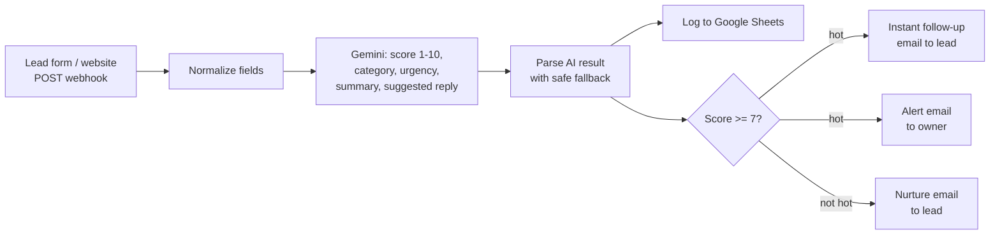

# AI Lead Qualification & Follow-up (n8n)

An automation that turns website enquiries into prioritised, followed-up leads without anyone touching an inbox.

A new enquiry hits a webhook, an LLM scores it, every lead is logged to Google Sheets, and then:

- **Hot leads** get an instant personalised email and the owner gets an alert with a summary and a suggested reply.
- **Everyone else** gets a polite nurture email.

Built with **n8n**, **Google Gemini**, **Google Sheets** and **SMTP**. No custom server required.

<!-- TODO: add demo video link here, e.g. "Watch the 90-second demo: https://..." -->

## The problem it solves

Small service businesses (HVAC, plumbing, clinics, salons, agencies) lose jobs because enquiries sit unanswered for hours, and the owner has no quick way to tell a ready-to-buy customer from someone browsing. This workflow:

- replies to every lead within seconds,
- ranks them so the owner calls the best ones first,
- keeps a complete record in a sheet the team already knows how to use.

## How it works



### Example AI output

For the message *"AC died today, it is 95 degrees and I need someone out ASAP. Happy to pay for same-day service."* the model returns:

```json
{
  "score": 10,
  "category": "hot",
  "urgency": "high",
  "summary": "Sara's AC stopped working on a 95-degree day and she is requesting emergency same-day service with willingness to pay.",
  "suggested_reply": "Hi Sara, we understand how miserable it is to be without AC in 95-degree heat, and we want to help you ASAP. Please give us a call or reply directly to this message so we can get a technician dispatched to your location today."
}
```

For *"just looking at prices, maybe next year"* it returns `score: 1`, `category: "cold"`, and the lead gets only the nurture email. See [`examples/sample-leads.csv`](examples/sample-leads.csv) for how both appear in the sheet.

## Design decisions

- **Structured output.** Gemini is asked for JSON only (`responseMimeType: application/json`), so downstream steps never parse free text.
- **Fails safe.** If the AI response cannot be parsed, the lead is scored 5 / "warm" and flagged for manual review, so no lead is dropped.
- **Resilient to API hiccups.** The Gemini call has a 30-second timeout and retries up to 4 times, because real APIs return temporary overload errors.
- **Logging never blocks follow-up.** Sheets and email run in parallel branches, and a Sheets failure is set to continue, so a spreadsheet problem cannot delay a customer reply.
- **No hallucinated promises.** The prompt forbids inventing phone numbers, prices, addresses, availability or arrival times, so the AI cannot commit the business to anything it has not confirmed.
- **Swappable parts.** Sheets can be replaced with HubSpot, Airtable or GoHighLevel, SMTP with any email provider, and Gemini with another model by changing one node.

## Setup

You need an n8n instance (n8n Cloud or self-hosted), a Gemini API key, a Google account, and an SMTP mailbox.

1. **Import** `workflow/lead-qualification-workflow.json` into n8n (Workflows, then Import from file).
2. **Gemini credential:** create a *Header Auth* credential with name `x-goog-api-key` and your key from [Google AI Studio](https://aistudio.google.com/apikey), and select it in the **Gemini: Qualify Lead** node.
3. **Google Sheets:** create a sheet with a tab named `Leads` and this header row (lowercase):
   `received_at, name, email, phone, service, message, score, category, urgency, summary`.
   Add a Google Sheets credential in n8n and paste the sheet ID into the **Log to Google Sheets** node.
4. **SMTP:** create one SMTP credential (host, port, user, password) and select it in all three email nodes.
5. **Replace the placeholders:**
   - `Your Business <you@yourdomain.com>` in the From field of all three email nodes (must match your SMTP mailbox),
   - `owner@example.com` in **Alert Owner (SMTP)**,
   - `https://yourdomain.com/book` in **Instant Follow-up to Lead (SMTP)**.
6. **Test** with the requests in [`examples/test-requests.md`](examples/test-requests.md), then toggle the workflow to **Active** and use the Production URL.

### Webhook input

`POST` JSON to the webhook:

```json
{ "name": "Sara Khan", "email": "sara@example.com", "phone": "+14045550123", "service": "Emergency AC repair", "message": "..." }
```

Any form tool that can send a webhook (Typeform, Tally, Webflow, WordPress plugins, a custom form) can feed it.

## Customising for a client

- **Scoring rules:** edit the system prompt in the Gemini node (for example "score higher for commercial jobs" or "ignore leads outside the service area").
- **Hot threshold:** change `7` in the **Hot lead?** node.
- **Tone and branding:** edit the email subjects and bodies, or add the business name to the prompt.
- **Extra channels:** add a Slack, SMS or WhatsApp branch off the hot-lead output.
- **CRM instead of Sheets:** replace the **Log to Google Sheets** node with the client's CRM node.

## Hardening for production

- Protect the webhook (n8n supports Header Auth on the Webhook node) so only your form can call it, since an open URL lets anyone trigger emails and API usage.
- Add a spam or honeypot check before the AI step if the form is public.
- Review the first few AI-written replies before turning on automatic sending for a client.
- Model names change over time. The workflow uses `gemini-3.5-flash-lite`; if Google retires it, update the model in the node URL.

## Tech stack

n8n · Google Gemini API · Google Sheets · SMTP · Webhooks · JavaScript (Code node)

## About

Built by [Codivity](https://codivity.co), which designs and builds AI automations and tools for businesses.

<!-- TODO: add Upwork profile link or contact line here -->

## License

MIT. See [LICENSE](LICENSE).
